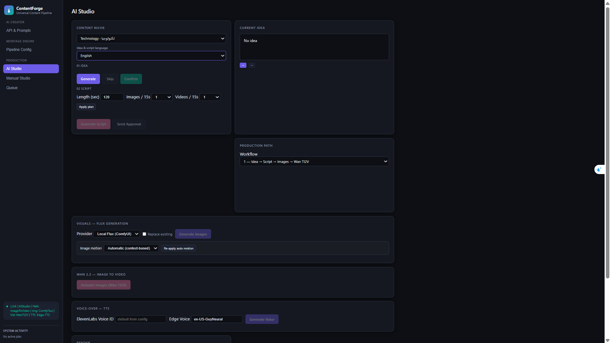
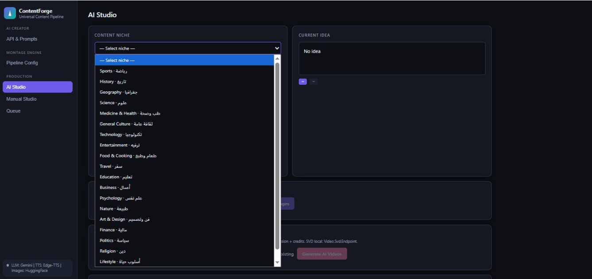
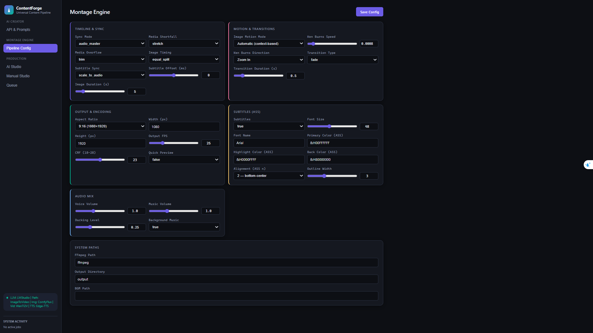
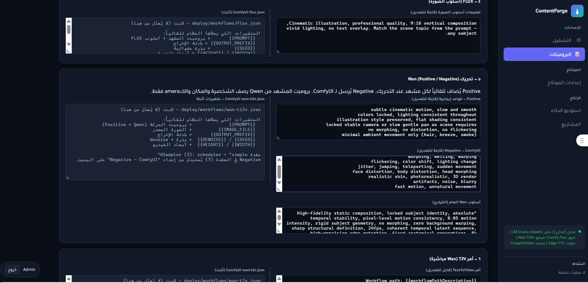
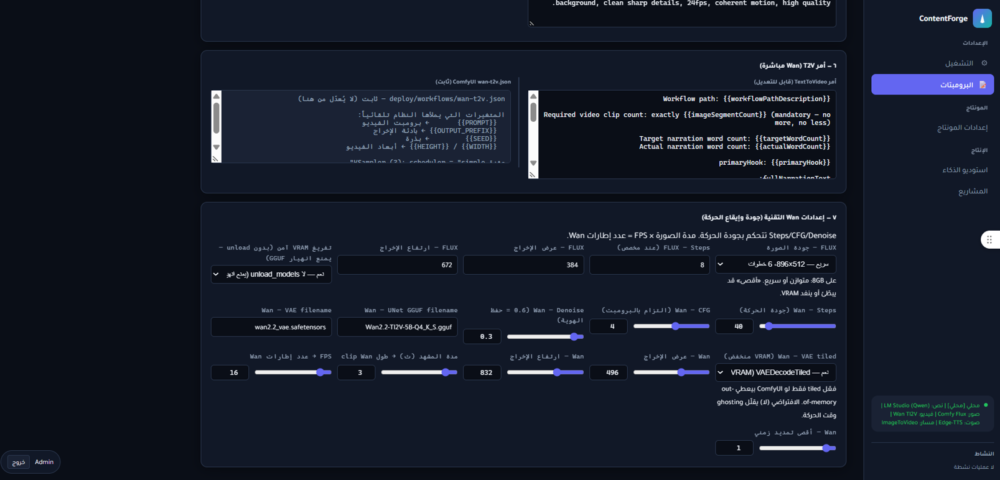

# ContentForge: AI Video Content Automation Pipeline

End-to-end system that turns a topic into a finished short video with
voiceover and subtitles, with human approval gates and full control
over every stage of the pipeline.

## How it works

1. **Pick a topic and language** from the dashboard
2. **Generate an idea**, then approve it or regenerate
3. **Generate the script** (structure and writing style are configurable)
4. **Plan scenes and generate images**: the LLM writes an image prompt per scene (Flux via ComfyUI)
5. **Animate images**: the LLM writes motion prompts, then Wan 2.2 image-to-video
6. **Voiceover** via ElevenLabs (Edge TTS as an alternative)
7. **Assemble** clips, voice, subtitles and music into the final video with FFmpeg

## Key features

- **Multi-topic, multi-language** content generation
- **Human-in-the-loop**: approve or regenerate the idea before spending GPU time
- **Fully configurable prompts** for every stage: idea, script, scene planning,
  image prompts, and Wan motion prompts (positive/negative)
- **Visual style control**: cinematic, realistic, anime, etc.
- **FFmpeg assembly controls**: subtitles, background music with ducking,
  transitions, Ken Burns motion, aspect ratio, quality, quick-preview mode
- **Hybrid local/cloud providers**: Ollama or LM Studio (Qwen) locally;
  OpenAI, Gemini and HuggingFace as cloud options
- **GPU orchestration**: cooldowns, VRAM-aware cleanup and automatic ComfyUI
  restart when switching between Flux and Wan on a single GPU
- **Settings-driven**: provider keys and models are stored as settings,
  never hard-coded in source

## Architecture

Clean Architecture in .NET:

| Project | Responsibility |
|---|---|
| `ContentEmpireSystem.Api` | REST API and controllers |
| `ContentEmpireSystem.Core` | Domain logic, enums, settings keys |
| `ContentEmpireSystem.Infrastructure` | ComfyUI client, LLM connectors, GPU orchestration, video generation |

## Tech stack

C# / .NET, ASP.NET Core, SQLite, ComfyUI (Flux for images, Wan 2.2 for
image-to-video), Qwen via LM Studio / Ollama, ElevenLabs (TTS), FFmpeg.

## Setup

Requirements: .NET SDK, ComfyUI, FFmpeg, and a local LLM server (LM Studio or Ollama).

```bash
git clone <repo-url>
cd <repo>
cp .env.example .env     # fill in your own values
dotnet run --project src/ContentEmpireSystem.Api
```

Required values in `.env`: `Auth__Jwt__Key` (a strong random string, 32+ chars)
and `Auth__BootstrapAdmin__Password`. Provider settings (models, endpoints,
prompts, FFmpeg options) are managed through the settings system.

## Status

The backend pipeline is working. The web dashboard is under development
and is not included in this repository.

## Demo

_Demo video / screenshots coming soon._

## Screenshots

### AI Studio


### Content niches


### Montage engine (pipeline config)


### Prompts (FLUX and Wan)


### Wan technical settings

